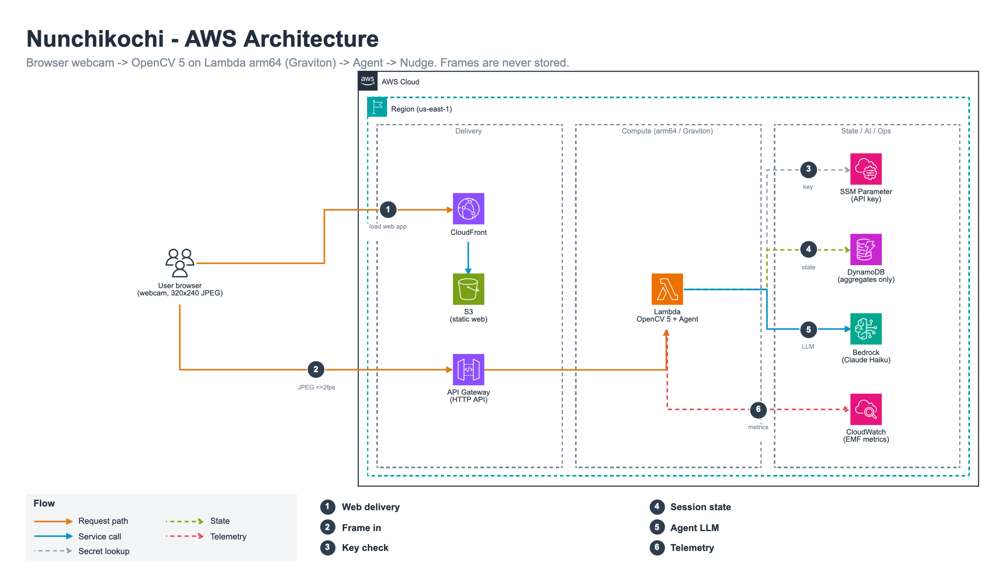
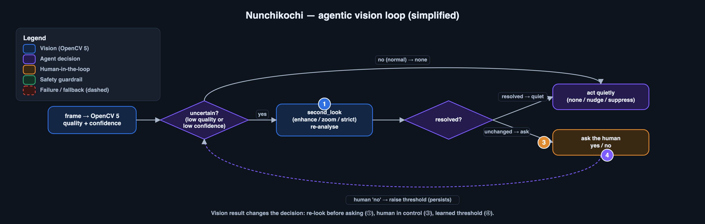

# Nunchikochi (눈치코치)

*A calm desk coach that reads posture and fatigue cues with OpenCV 5 and lets an agent decide whether to nudge, stay quiet, or look again. Built for the OpenCV AI Competition 2026.*

Your browser webcam sends a small JPEG about twice a second. An AWS Lambda function on **arm64 (Graviton)** decodes it in memory, runs **OpenCV 5** (`cv2.dnn` ONNX models: face detection, 478-point face mesh, palm detection), turns the result into behaviours (head tilt, forward head, away, blink, yawn, drink), and a small **agent** decides what to do. **Frames are never stored**: they are analysed in memory and discarded; only aggregates and filter state (<= 8 KB, 24 h TTL) are kept.



## What is agentic here

The vision result changes what the agent plans, which tools it calls, and when it asks a human. When quality is poor or confidence is borderline, the agent calls `second_look` (re-analyses the same in-memory frame with `enhance`, `zoom_face` or `strict`) *before* bothering anyone; a human "no" raises that behaviour's threshold and it persists. An optional Bedrock planner (Claude Haiku) can only propose; whitelist, no-diagnosis and length guardrails plus a timeout fall back to rules.



Evidence for the claims (traces, tests, reproduction commands): [`docs/submission/AGENTIC_VISION.md`](docs/submission/AGENTIC_VISION.md), full diagram [`docs/diagrams/agent_workflow.png`](docs/diagrams/agent_workflow.png).

## Try it

**Live review deployment** (kept until 2026-11-10): see [`docs/cloud/ENDPOINT.md`](docs/cloud/ENDPOINT.md). The web app has a **Demo** mode (no camera, recorded session) and a **Live** mode (your webcam; needs an access key that is supplied separately with the submission).

**Run locally in a few minutes** (no AWS needed):

```bash
scripts/run_local.sh      # uv environment, model download + checksum, service, web
scripts/test_all.sh       # vision + agent + service + e2e tests
```

Details, prerequisites and the AWS deployment procedure: [`docs/REPRODUCE.md`](docs/REPRODUCE.md), [`cloud/README.md`](cloud/README.md). Dependencies are pinned in `pyproject.toml` / `uv.lock` (OpenCV `opencv-python-headless==5.0.0.93`).

## Repository map

| path | what |
|---|---|
| `src/nunchi/vision` | OpenCV 5 pipeline: YuNet face detection, FaceMesh landmarks, quality checks, calibration, behaviour state machines, palm detector |
| `src/nunchi/agent` | decision loop, tools (`second_look` etc.), guardrails, optional Bedrock planner, image-free trace |
| `src/nunchi/service` | FastAPI service (HTTP API in `docs/CONTRACTS.md`), session state, metrics, rate limits |
| `web/` | static web app (Demo/Live modes, overlay, agent panel, report), Playwright e2e |
| `cloud/` | CloudFormation template, one-command deploy/destroy (dry-run by default), arm64 zip packaging |
| `eval/`, `docs/eval/` | evaluation harnesses and reports (vision, robustness, agent, web) |
| `models/` | model manifest with licences and SHA-256 (weights are downloaded, not committed) |
| `docs/report/TECHNICAL_REPORT.md` | technical report |

## Evaluation and honest limits

- Tests: 266 passing (vision, agent, service, e2e, independent review); web e2e 27/27.
- Measured on the deployed stack (Lambda arm64, 1536 MB): engine analysis **148 ms median / 157 ms p95** per frame, cold-start Init ~2.5 s ([`docs/cloud/LATENCY.md`](docs/cloud/LATENCY.md)).
- **Not yet measured**: per-behaviour accuracy on real recorded clips. Vision robustness numbers are from synthetic transforms and public sample images and must not be read as real-world accuracy ([`docs/eval/VISION_EVAL.md`](docs/eval/VISION_EVAL.md), [`docs/eval/VISION_ROBUSTNESS.md`](docs/eval/VISION_ROBUSTNESS.md)).
- Blink counting is limited by ~2 fps sampling; we report an eyes-closed fraction instead. `drink` is implemented conservatively and unvalidated on real clips.
- Agent evaluation uses deterministic stubs and scenarios written by us; failures are kept in the report.
- Best Use of COOL is **not pursued** (COOL is an AWS Marketplace AMI; this service is a Lambda zip).

License: MIT (code). Third-party model weights keep their own licences, see `models/MANIFEST.json`.

## Responsible use

Wellbeing coaching only: no medical diagnosis, no identification or recognition of people, no frame storage, no cross-user data. See the privacy page in the web app and `docs/report/TECHNICAL_REPORT.md` section 8.

## Documents

[Architecture](docs/ARCHITECTURE.md) · [Contracts](docs/CONTRACTS.md) · [Decisions](docs/DECISIONS.md) · [Reproduce](docs/REPRODUCE.md) · [Independent review](docs/review/Q1_REPORT.md)
