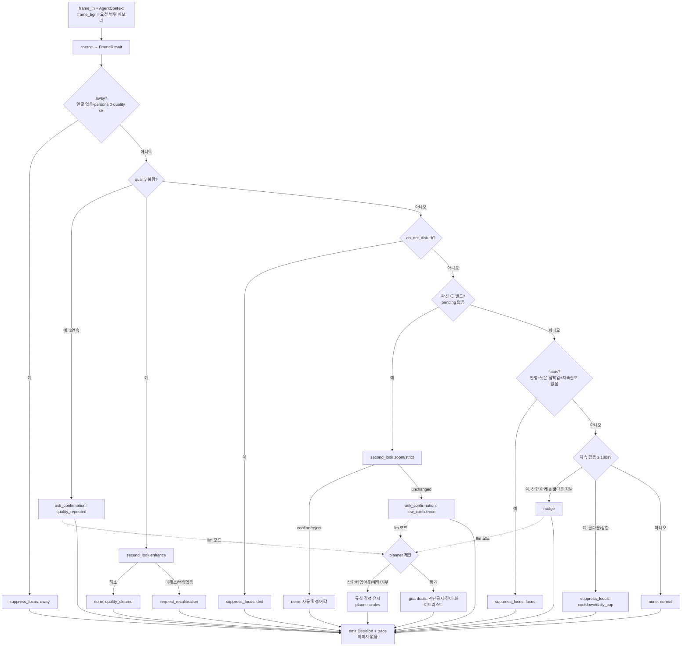
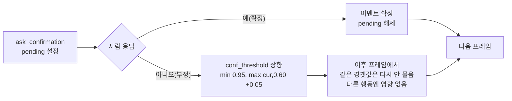
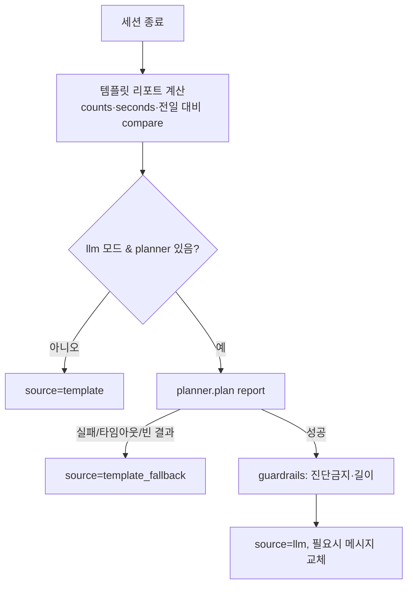

# 에이전트 워크플로우 스펙 (AGENT_WORKFLOW_SPEC)

Agentic Vision 부문 제출용 그림의 **원천 스펙**이다. 지휘자가 이 스펙으로 그림을 그린다.
여기 적힌 노드·엣지·분기·도구·실패 경로는 **전부 실제 코드**(`src/nunchi/agent/`)에서 왔다.
코드에 없는 분기는 쓰지 않는다. 코드가 바뀌면 이 문서를 먼저 고친다(코드 우선).

- 결정 루프: `agent.NunchiAgent.decide()` → `policy.decide()`(규칙) → (llm 모드)`planner.run_with_budget()` → `guardrails.apply_guardrails()`
- 사람 응답 반영: `agent.resolve_confirmation()` → `policy.apply_confirmation()`
- 리포트: `agent.report()`(세션 종료 시 1회)
- 핵심 불변: **프레임/이미지/좌표는 저장·반환·trace에 남지 않는다.** `frame_bgr`는 요청 처리 중 메모리 참조로만 존재하며 `second_look`이 비전에 넘길 뿐이다.

---

## 1. 노드 (한 프레임의 perceive → decide → act)

| 노드 | 코드 위치 | 하는 일 | 사람 개입 |
|---|---|---|---|
| `frame_in` | `decide()` 진입 | 프레임 1장 + `AgentContext` 수신. `frame_bgr`는 요청 범위 메모리 | - |
| `coerce` | `decide()._coerce` | `FrameResult` 또는 dict를 관대하게 정규화(누락 필드 기본값) | - |
| `vision_result` | 입력(비전 탭) | `FrameResult`(quality·events·face_present·persons). 이미지는 없음 | - |
| `rules_decide` | `policy.decide()` | 아래 우선순위 분기로 결정 1개 산출(도구 호출 포함) | - |
| `away?` | policy 0 | 얼굴 없음+persons 0+quality ok → 자리비움 | - |
| `quality_bad?` | policy 1 | quality 불량/얼굴 없음 | (반복 시) 예 |
| `second_look(enhance)` | `tools.second_look` | 비전 재분석(enhance)으로 품질 해소 시도 | - |
| `dnd?` | policy 2 | 방해 금지 설정 | - |
| `low_conf?` | policy 3 | 주 이벤트 확신이 밴드 `[thr_lo, 0.60]` | - |
| `second_look(zoom/strict)` | `tools.second_look` | 비전 재분석으로 확신 재판정 | - |
| `confirm_or_reject?` | policy 3 | 재분석 verdict가 confirm/reject면 자동 확정, unchanged면 사람에게 | (unchanged 시) 예 |
| `focus?` | policy 4 | 자세 안정 + 낮은 깜빡임 + 지속 신호 없음 → 집중 구간 | - |
| `sustained?` | policy 5 | 지속 행동이 `sustained_min_s` 이상 | - |
| `cooldown/cap?` | policy 5 | 넛지 쿨다운·일일 상한 확인 | - |
| `llm_refine?` | `decide()` llm 모드 | **애매한 순간에만** LLM이 규칙 결정을 개선 시도 | - |
| `guardrails` | `guardrails.apply_guardrails` | action/도구/쿨다운/DND 화이트리스트 + 진단 금지 + 길이 | - |
| `emit_decision` | `decide()` 끝 | 최종 `Decision` + trace 1줄(이미지 없음) | - |
| `human_reply` | `resolve_confirmation()` | 사람의 예/아니오 수신 | 예 |
| `raise_threshold` | `apply_confirmation()` | 아니오면 그 행동 확신 임계 상향(지속) | - |
| `report` | `report()` | 세션 종료 시 EN/KO 요약 + 전일 대비 | - |

행동(action) 종류(화이트리스트, `guardrails.ALLOWED_ACTIONS`):
`none`, `nudge`, `request_recalibration`, `ask_confirmation`, `suppress_focus`.

---

## 2. 엣지 조건 (규칙 결정의 우선순위 — 먼저 맞는 가지가 이김)

`policy.decide()`의 실제 순서. 안전·강건이 잔소리를 이기도록 설계.

| 순위 | 조건(엣지) | 결과 action | 도구 경로 |
|---|---|---|---|
| 0 | `not face_present and persons==0 and quality.ok and no issues` | `suppress_focus`(away) | `suppress` |
| 1a | quality 불량 **그리고** `bad_quality_streak >= quality_repeat_for_confirm(3)` | `ask_confirmation` | `get_quality` → `ask_confirmation` |
| 1b | quality 불량 → `second_look(enhance)`가 **해소** | `none` | `get_quality` → `second_look` |
| 1c | quality 불량 → 재분석 미해소(또는 변형 없음) | `request_recalibration` | `get_quality` → `second_look?` → `request_recalibration` |
| 2 | `do_not_disturb` | `suppress_focus`(dnd) | `suppress` |
| 3a | 주 이벤트 확신 ∈ `[thr_lo, 0.60]` → `second_look`이 confirm/reject | `none` | `second_look` |
| 3b | 밴드 그대로(unchanged) **그리고** `pending_confirmation is None` | `ask_confirmation` | `second_look?` → `ask_confirmation` |
| 4 | 조용함(`roll_spread<=3°`, `blink_rate<=0.2/s`, `t>=120s`) **그리고** 지속 신호 없음 | `suppress_focus`(focus) | `get_metrics_window` → `suppress` |
| 5a | 지속 행동 `>= sustained_min_s(180)` **그리고** 상한 아래 **그리고** 쿨다운 지남 | `nudge` | `send_nudge` |
| 5b | 지속이나 쿨다운/상한 걸림 | `suppress_focus`(cooldown\|daily_cap) | `suppress` |
| 6 | 위 어느 것도 아님 | `none` | - |

엣지 노트:
- 밴드 하한 `thr_lo`는 `ctx.conf_threshold[behavior]`가 있으면 그것(사람 거부로 상향된 값), 없으면 `low_conf_lo(0.40)`.
- `pending_confirmation`이 있으면 3b를 건너뛴다 → **한 번에 하나만 질문**(재질문 폭주 방지).
- `second_look`은 비전이 `analyze_variant`를 제공할 때만. 없으면 건너뜀(trace `skipped:no_variant`)·고전 경로 유지.

---

## 3. 도구 (7종, `tools.py` / CONTRACTS §2)

| 도구 | 입력 | 반환(요약) | 이미지? |
|---|---|---|---|
| `get_quality` | 현재 `FrameResult` | ok·brightness·sharpness·issues·face_present | 아니오 |
| `get_metrics_window` | 최근 이벤트 요약 리스트 | count·rate·roll_spread 등 | 아니오 |
| `second_look` | 비전·상태·`frame_bgr`·variant | before/after 품질·확신·verdict·resolved | **프레임은 비전에만 전달, 반환·trace에 없음** |
| `request_recalibration` | reason | 재보정 요청 기술 | 아니오 |
| `ask_confirmation` | EN/KO 질문·about·behavior | 사람 질문(needs_human) | 아니오 |
| `send_nudge` | behavior·EN/KO·cooldown | 넛지 기술(관찰 기반 문구) | 아니오 |
| `suppress` | reason·kind | 억제 기술(focus/dnd/away/rate) | 아니오 |

`second_look`의 variant: `enhance`(품질), `zoom_face`/`strict`(확신). 비전 상태는 갱신하지 않음.

---

## 4. 사람 개입 지점 (human-in-the-loop)

| 지점 | 트리거 | 사람이 하는 일 | 결과 |
|---|---|---|---|
| 저확신 확인 | 엣지 3b | 이벤트가 맞는지 예/아니오 | 예→확정 / 아니오→`raise_threshold` |
| 품질 반복 확인 | 엣지 1a | 자리 세팅 괜찮은지 | 세팅 점검 유도 |
| 임계 상향 지속 | `apply_confirmation(confirmed=False)` | (자동) | 그 행동 임계 `min(0.95, max(cur,0.60)+0.05)`로 상향, **이후 프레임에도 유지**, 다른 행동엔 영향 없음 |

사람에게 묻기 **전에** 항상 `second_look`(능동 지각)으로 비전이 먼저 대신 본다. 재분석이 해소하면 사람을 부르지 않는다.

---

## 5. 실패 처리 경로 (타임아웃·폴백·강건)

| 실패 | 코드 | 처리 | 최종 |
|---|---|---|---|
| 비전 `second_look` 예외 | `policy._try_second_look` try/except | trace `error:<Type>`, 재분석 없음으로 폴백 | 고전 경로(재보정/사람) |
| 비전 변형 미제공 | `second_look` available=False | trace `skipped:no_variant` | 고전 경로 |
| LLM 상한 초과 | `run_with_budget` `over_cap` | 규칙 결정 유지 | trace `|llm_over_cap`, planner=rules |
| LLM 타임아웃(`> llm_timeout_s`) | `run_with_budget` `timeout` | 규칙 결정 유지 | trace `|llm_timeout`, planner=rules |
| LLM 예외 | `run_with_budget` except | 규칙 결정 유지 | planner=rules |
| LLM 금지 action/도구/인자 | `guardrails.check_plan` | 거부 | trace `|guardrail:<reason>`, planner=rules |
| LLM 진단 문구 | `guardrails.sanitize_message` | 안전 템플릿으로 교체(action 유지) | planner=llm, 메시지 교체 |
| 리포트 LLM 실패/타임아웃/빈 결과 | `report()` | 템플릿 리포트 | source=`template_fallback` |
| 결정 루프 내부 예외(무엇이든) | `decide()` try/except | 안전 action으로 강등 | `request_recalibration` |

원칙: **LLM은 제안만, 가드레일·규칙이 안전/비용/지연의 바닥.** 평상시 프레임은 규칙 경로(지연 0·비용 0), LLM은 애매한 순간에만.

---

## 6. Mermaid — 한 프레임 결정 루프

## 7. Mermaid — 사람 확인 → 임계 갱신 (프레임 간)

## 8. Mermaid — 세션 종료 리포트

---

## 9. 그림 그릴 때 유의 (지휘자용)

- 세 Mermaid는 각각 **프레임 결정 / 사람 확인·임계 갱신 / 리포트**다. 한 장으로 합치려면 "결정 루프" 박스에서 `ask_confirmation`이 7번 다이어그램으로 이어지는 점선을 둔다.
- "OpenCV 결과가 행동을 바꾼다"를 강조하려면 `vision_result → rules_decide`, 그리고 `second_look`이 사람 호출 **앞**에 있는 점을 색으로 표시.
- 사람 개입 지점(§4) 3곳을 사람 아이콘으로.
- 실패/폴백(§5)은 빨간 점선으로. "LLM은 제안, 규칙·가드레일이 바닥"을 캡션으로.
- 적대·경계 결과(`docs/eval/AGENT_EVAL.md`의 적대 절)를 "강건함" 캡션의 근거로 링크.
- 코드에 없는 분기(예: 자동 치료·외부 호출·이미지 저장)는 그리지 않는다.
