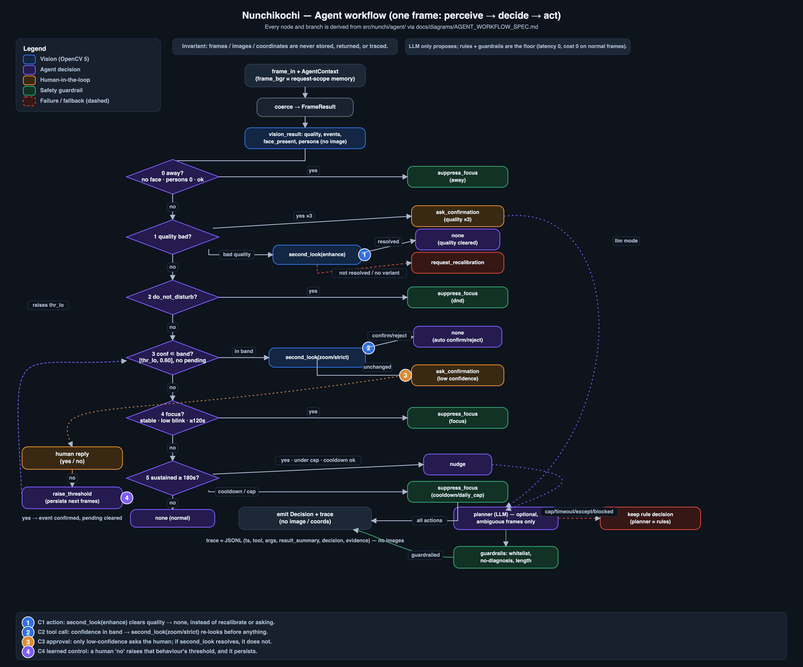

# Nunchikochi — Technical Report

*OpenCV AI Competition 2026 (powered by AWS). Draft; evidence paths are repo-relative.*

Nunchikochi is a desk-ergonomics self-awareness tool. A laptop webcam feed is read by
**OpenCV 5** and an **agent decision loop** decides, each frame, whether to nudge the
person, stay silent, or look again — never storing the video. "Nunchi" (눈치) is the
Korean sense of reading a situation; the tool reads *your own* posture and attention
signals and coaches gently.

This report covers: problem, intended users, architecture, OpenCV 5 implementation,
AWS deployment, evaluation, limitations, and responsible use. Every quantitative claim
cites a repo document; numbers we have not measured yet are marked **[PENDING: …]** and
collected at the end. Where two documents disagree we follow the code and record the
conflict in PENDING.

*Figure 1. Deployed architecture: browser frames go through API Gateway to a Lambda arm64 (Graviton) function running OpenCV 5 and the agent; only aggregates are stored.*

---

## 1. Problem

People doing focused desk work drift into habits they do not notice in the moment:
leaning toward the screen, a tilted head, long "deep" blinks, yawning, forgetting to
drink water, or stepping away. These are small, cumulative ergonomic signals. Existing
tools either ignore them, or over-correct with constant, context-blind alerts that
users quickly silence.

Two design problems follow:

1. **Perception** must be cheap, private, and robust enough to run continuously on a
   normal webcam, in normal (often poor) lighting, without sending video anywhere.
2. **Judgement** must be restrained. A signal is not a reason to interrupt. The tool
   should respect focus, avoid nagging, confirm when unsure, and never make a medical or
   emotional claim. The hard part is *when to stay quiet*.

Nunchikochi treats perception (OpenCV) and judgement (the agent) as separate, testable
components, connected only by a typed contract that never carries an image
(`docs/CONTRACTS.md`). This is also the basis of our **Agentic Vision** entry: the
visual result changes what the agent does next (see §6 and
`docs/submission/AGENTIC_VISION.md`).

## 2. Intended users

- **Primary**: an individual knowledge worker who wants gentle, private self-feedback on
  posture and attention during long desk sessions — on their own machine, for their own
  benefit.
- **Secondary**: accessibility- and wellbeing-minded users who want on-screen, non-audio
  cues and full keyboard control (the web UI passes WCAG 2 A/AA hard checks,
  `docs/eval/WEB_E2E.md` §2).

**Explicit non-users / non-goals** (`docs/ARCHITECTURE.md` "비목표"): this is not a
medical or emotional-state diagnostic, not a multi-person monitor, not a surveillance or
productivity-scoring tool for an employer, and it does not store or replay video or
identify faces. Consent is explicit and the camera-on state is always shown.

## 3. Architecture

One line (`docs/ARCHITECTURE.md`): browser webcam → low-resolution JPEG frames,
processed **in memory only** → **OpenCV 5 inside an AWS Lambda arm64 (Graviton)
container** → features and events → **agent decision loop** → nudge / confirm / silent →
DynamoDB (aggregate numbers only) → an end-of-session report (Amazon Bedrock).

Components map to one owning area each:

| Area | Package / path | Responsibility |
|---|---|---|
| web | `web/` | `getUserMedia` capture, 320×240 JPEG @ ~2 fps, overlay + nudges, demo/mock modes |
| vision | `nunchi.vision` | OpenCV 5 analysis: face detect, landmarks, metrics, quality, `analyze_variant` |
| agent | `nunchi.agent` | perceive→decide→act loop, 7 tools, guardrails, JSONL trace, Bedrock report |
| cloud | `cloud/`, `nunchi.service` | FastAPI service, Lambda arm64 zip, CloudFormation, state store, observability |

Boundaries cross only through `nunchi.contracts` dataclasses, all JSON-serialisable and
**image-free by construction** (`FrameResult`, `Decision`, `SessionSummary`). The same
service runs locally under `uvicorn` for development and ships unchanged to AWS.

**Key decisions** (`docs/ARCHITECTURE.md`):

- **Session state lives in DynamoDB** (`pk=SESSION#id, sk=STATE`, 24 h TTL), not in Lambda
  memory and not in a signed client token. Rationale: Lambda instances do not share
  memory; a per-frame get+put is a few ms against a 250 ms vision budget; TTL auto-expiry
  keeps it cheap; cold starts and instance swaps are unaffected. Local dev uses an
  in-memory adapter with the same interface (`NUNCHI_STATE_BACKEND=memory`).
- **Lambda packaging is an arm64 zip**, not a container. Arm64 manylinux wheels
  (`opencv-python-headless 5.0.0.93` + `numpy 2.2.6` + FastAPI/Mangum) strip to ~130 MB,
  plus ~5 MB models ≈ ~135 MB, well under the 250 MB unzipped limit (`cloud/README.md`,
  "Packaging"). `boto3` is excluded (provided by the runtime). A container path is kept
  only as a fallback if COOL (§5, §7) turns out to be container/AMI-only.

*Figure 2. Agent workflow for one frame (full). A simplified loop is in `docs/diagrams/agent_workflow_compact.png`.*

## 4. OpenCV 5 implementation

All vision runs on **OpenCV 5**, pinned to `opencv-python-headless==5.0.0.93`
(`cloud/requirements-lambda.txt`, `docs/ARCHITECTURE.md`). No external inference
framework (e.g. MediaPipe) is used — detection and landmarks are OpenCV DNN models, and
all geometry/quality is OpenCV + NumPy.

**Detection and landmarks**

- **Face detection**: YuNet via `cv2.FaceDetectorYN` (OpenCV Zoo).
- **Face landmarks**: a FaceMesh ONNX model (478 points, Apache-2.0) run through
  `cv2.dnn` (`docs/STATUS.md` V2). Eye-aspect-ratio (EAR), mouth-aspect-ratio (MAR), head
  roll, a forward/pitch proxy, and face scale are computed from these points.
- **Hand (for `drink`)**: V7 adds an optional palm detector (MediaPipe palm ONNX,
  Apache-2.0) via `cv2.dnn` on OpenCV 5 (`src/nunchi/vision/hands.py`), keeping palm-box
  centres only — no 21-point skeleton, no cup/bottle model. The engine computes
  `hand_mouth_dist` on the real `analyze` path and emits `drink` from it; it is **never**
  computed on a variant path, so `second_look`/`zoom_face` cannot fabricate a `drink`.
  The model is optional: if the file is absent, `drink_supported=False` and no `drink`
  is emitted (`src/nunchi/vision/engine.py`).
- **Primary-face selection** (`select_primary_face`, `docs/eval/VISION_ROBUSTNESS.md`
  §3): the largest face, tie-broken toward screen centre — deterministic — so a person
  walking past in the background cannot hijack the analysis.

**Image quality and correction** (OpenCV/NumPy)

- Per-frame **quality** checks produce `too_dark` / `too_bright` / `blurry` /
  `face_too_small` / `face_cut_off` / `no_face` / `multiple_faces` from brightness (mean
  luma), sharpness (variance of Laplacian), and face-box size.
- **`analyze_variant`** re-analyses the *same* frame a different way for the agent's
  "second look": `enhance` applies **CLAHE + gamma** correction, `zoom_face` crops and
  upscales the face, `strict` raises thresholds. State is never mutated by a variant
  (`docs/CONTRACTS.md` §1).

**Robustness-driven structural work** (`docs/eval/VISION_ROBUSTNESS.md`): a synthetic
sweep surfaced weak spots and we hardened *selection and quality only*, not thresholds:
a `multiple_faces` significance gate (`SECONDARY_MIN_AREA_RATIO=0.4`) removes
background-face false positives; a roll-aligned EAR (`metrics.roll_aligned_ear`) reduces
blink instability under head rotation (EAR variation at ±10° dropped 0.083 → 0.025); and
a small-face retry (`landmarks.extract_best`, 2× upscale) recovers detection on distant
faces (detection rate at ~30% face size 0.5 → 1.0) for **+4.4 ms p95** only. That change
bumped the state serialization schema to **2.0** and mixing pre-V6 baselines is refused
with a `ValueError` (forces recalibration).

**Latency** (`docs/cool/RESULTS_local.md`, `docs/eval/VISION_ROBUSTNESS.md` §6): on a
local **Apple Silicon arm64** dev machine (explicitly **not** Graviton), the `analyze`
hot path is **median 12.69 ms / p95 13.69 ms, 78.82 fps, peak RSS 97.4 MB**; a normal
frame on the V6 path is p95 ≈ 9.2 ms, and a small-face retry frame p95 ≈ 13.6 ms. All are
under the 250 ms contract budget. On the deployed **AWS Graviton** Lambda (1536 MB) the
measured engine time is **148 ms median / 157 ms p95** with a **2.5 s median cold-start
Init** (`docs/cloud/LATENCY.md`, section 5); it is a different environment and not directly
comparable to the laptop figure.

## 5. AWS deployment

The core workload runs on AWS; the browser only captures and displays
(`cloud/README.md`, `docs/ARCHITECTURE.md`).

- **Compute**: a single **Lambda function, arm64 (Graviton), Python 3.12**, FastAPI under
  Mangum, 1536 MB / 15 s timeout, **ReservedConcurrency 5** as a hard cost and
  blast-radius ceiling. A **Lambda Function URL** (AuthType NONE) fronts it; the real auth
  is an app-level `X-Api-Key`.
- **Static web**: S3 (private) + CloudFront with **Origin Access Control**; the bucket
  blocks all public access and only CloudFront reads it.
- **State / storage**: DynamoDB `nunchi-sessions`, on-demand, with TTL — aggregate state
  and summaries only, never images or raw landmarks.
- **Secrets**: the API key is an **SSM SecureString** read at runtime and never written to
  the template, logs, or the client config file; if it is set but unresolvable the service
  **fails closed** (`503 auth_unavailable`), never open.
- **Observability** (`cloud/README.md` "Operations"): CloudWatch **Embedded Metric
  Format** (no `PutMetricData`, no extra IAM) emits `FrameLatencyMs`, `Decisions`,
  `Errors`, `RateLimited`, `Sessions` — **numbers and bounded labels only**, never image
  bytes, bodies, keys, headers, or session ids (enforced by a test). A dashboard and three
  alarms (throttles, function errors, app-error flood) are in the template.
- **Abuse defense (defense in depth)**: reserved concurrency 5; API key with fail-closed;
  a 200 KB request cap (`413`); a per-session server-side frame-rate limit
  (`429 rate_limited`, frame bytes dropped, body never echoed); a `$20` monthly budget;
  CORS restricted to the CloudFront domain. All resources carry
  `project=nunchikochi` / `delete-after=2026-11-30`.
- **Packaging / deploy**: `cloud/package.sh` builds the arm64 zip (no Docker);
  `cloud/deploy.sh` / `destroy.sh` are **one command each and default to dry-run**
  (print every mutating call, run nothing) — a real deploy needs `--apply`.

**Estimated cost** at demo scale (~50k frame invocations/month): Lambda ≈ $0.30,
DynamoDB ≈ $0.20, CloudFront ≈ $0.50, S3 ≈ $0.05, CloudWatch ≈ $0.50 → **≈ $1–2 / month**,
idle ≈ $0 (all usage-priced, no NAT, no provisioned capacity) (`cloud/README.md`). The
$20 budget alarm is the backstop. **Measured on the deployed stack** (AWS Lambda arm64 / Graviton, 1536 MB, us-east-1,
2026-10-22; `docs/cloud/LATENCY.md`): the engine's per-frame analysis time is
**148 ms median / 157 ms p95** (100 warm frames, 320x240 JPEG, one face); a forced cold
start costs **2.5 s median Init** (n=5, models load once at init) plus the same ~150 ms
analysis; client round-trip from Korea is ~1.0 s and is network-dominated. 1536 MB is about
32% faster than 1024 MB for about 2% more GB-ms cost. The workload is ~2 frames/s, so a
~150 ms analysis fits the budget. The local Apple-Silicon figure (12.69 ms) is a different
environment and must not be compared as same-hardware; we have not profiled why Graviton at
1536 MB is slower than the laptop (vCPU share and pip build flags are candidates, untested).

## 6. Evaluation

Evaluation is split by component and reported **as-is**, failures included.

**Vision behaviour accuracy** (`docs/eval/VISION_EVAL.md`): **currently unmeasured.**
There are no real labelled clips yet; the per-behaviour precision/recall/F1 table is
filled automatically once the user records clips (`eval/record_clips.py`) and runs
`eval/run_vision_eval.py`. Synthetic/public-sample numbers are deliberately **not** used
as performance. → **[PENDING: real-clip vision accuracy (P/R/F1 by behaviour, by
lighting), gated on U1 clip recording]**.

**Vision robustness** (`docs/eval/VISION_ROBUSTNESS.md`): measured on **public OpenCV
samples (4 images) + synthetic transforms** — a structural weakness probe and regression
guard, explicitly **not** real-world performance. It locates the weak spots honestly:
detection is robust to JPEG compression and brightness/gamma; it degrades under heavy
motion blur (detect rate 0.75 at `mb17`), salt-and-pepper noise ≥8% (0.5), and very small
faces (**faces under ~15% of the frame are not detected**, mitigated by the V6 retry);
and EAR becomes unstable past ±20° rotation. Glasses are **unmeasured** (no public
sample; not faked).

**Web end-to-end & accessibility** (`docs/eval/WEB_E2E.md`): Playwright browser e2e
**27/27 passed**; a local live integration against `uvicorn` with a fake camera **6/6
passed**; axe-core WCAG 2 A/AA scans show **0 hard violations** (two remaining items are
hand-verified contrast advisories on a zero-area footer span). Run in demo/mock mode; no
real camera or AWS needed.

**Agent decision quality** (`docs/eval/AGENT_EVAL.md`, `docs/submission/AGENTIC_VISION.md`):
the agent is evaluated with a deterministic harness (stubbed vision/LLM, no network).

- 22 deterministic scenarios, **22/22 pass**; `second_look` is exercised in 7 and
  **changed the decision in 3 (42.9%)**; 9 scenarios ask the human; 3 exercise a fallback;
  avg 2.5 tool calls, avg 2.4 ms/scenario.
- 9 **adversarial/boundary** scenarios (tool-arg outliers, inconsistent tool results,
  LLM-invented tools, instruction-bypass wording, conflicting signals, borderline
  oscillation, missing context, budget exhaustion): 8/9 held as expected; the 1 mismatch
  is kept as a **FAIL with a written analysis** (the agent is correct; the scenario's
  step-1 expectation overlooked the one-question-at-a-time rule) rather than tuned green.
- Deepened guardrail tests pin: image/byte-free traces, no-diagnosis across many EN/KO
  phrasings, cooldown/daily-cap suppression at the policy level, and a human-denial
  threshold raise that persists across frames. These tests found and fixed two real
  defects in the no-diagnosis filter (an over-broad `you have` false positive and a
  missing `you seem exhausted` variant).
- **Agentic Vision**: five human-readable demo traces (`docs/submission/traces/`) show the
  vision result changing the action — a dark frame cleared by `second_look(enhance)` →
  silent; low confidence → ask the human; a forbidden LLM action → guardrail reject →
  rules; a real Bedrock call exceeding the 1 ms budget → rules fallback; a human "no" →
  raised threshold. The whole-project test suite is **242** (`docs/STATUS.md`).

LLM cost: normal frames are the rules path (zero latency, zero cost); the Bedrock planner
(Amazon Nova/Claude Haiku-class, Haiku 4.5 used) is called only on ambiguous moments.
Development Bedrock spend to date ≈ **$0.012** against a $2 cap (`agent/llm_calls.jsonl`,
prompts stored as hashes only).

## 7. Limitations (honest)

- **No real-clip vision evaluation yet.** All behaviour accuracy is unmeasured; robustness
  numbers are synthetic (4 public samples + transforms) and do not generalise until real
  clips (U1) are recorded. Thresholds are conservative starting values, deliberately
  **not** tuned on synthetic data.
- **`drink` support is conditional, and a doc is stale.** `drink` (hand-to-mouth) is
  **implemented** in V7 via an OpenCV `cv2.dnn` palm detector
  (`src/nunchi/vision/hands.py`, `src/nunchi/vision/engine.py`): on the real `analyze` path the engine fills
  `hand_mouth_dist` and emits `drink` **when the optional palm model file is present**
  (`drink_supported`); otherwise it is silently disabled. **Conflict**: `docs/eval/VISION_EVAL.md`
  still says drink is "unsupported (no hand model)", which predates V7. Resolved here in
  favour of the **code** (conditionally supported, palm model required, never on variant
  paths). The behaviour's real accuracy is still unmeasured (no real clips, and `drink`
  needs the palm model present at run time). → see PENDING.
- **Blink is undercounted at low fps.** At ~2 fps a 200 ms blink usually falls between
  frames; single-frame catches undercount. We provide a PERCLOS-like
  `eyes_closed_fraction()` and catch sustained closure (≥0.7 s) as `deep_blink` instead.
- **Agent evaluation is stub-based.** The harness uses `StubVision` / `FakeLLM`; 100% is
  specification conformance and robustness, not a generalisation claim. Scenarios are
  self-written. LLM metrics are smoke-level (a handful of live calls).
- **COOL challenge deferred.** The "Best Use of COOL" prize wants a reproducible
  COOL-vs-baseline gain on Graviton, but **COOL ships only as a Marketplace AMI**, while
  our stack is a Lambda arm64 zip with pip `opencv-python-headless`
  (`docs/cool/LISTING_NOTES.md`). There is no supported way to drop COOL into a Lambda
  zip, so a true A/B would require standing up a Graviton EC2 from the COOL AMI (a
  subscription = U2, out of scope). We publish an honest local arm64 baseline (12.69 ms,
  `docs/cool/RESULTS_local.md`) and keep the COOL row empty; AWS's published 20–70% COOL
  gain is **cited, not claimed as ours**. → not pursued (decision 2026-10-22).
- **Deployment numbers come from one small run.** The Graviton latency (n=100 warm,
  n=5 cold) is measured on the deployed stack, but from a single region/client and one
  sample image; monthly cost is an estimate from public pricing, not a bill. The reason
  Graviton at 1536 MB is slower than the Apple-Silicon laptop is not investigated.

## 8. Responsible use

- **Not a medical or emotional diagnosis.** The tool reports *observations* ("your head
  has been tilted for a while"), never states or health ("you look tired"). A deterministic
  no-diagnosis guardrail blocks such phrasings in both English and Korean and replaces
  them with a safe template; it is enforced after any LLM output and covered by tests
  (`src/nunchi/agent/guardrails.py`, `docs/submission/AGENTIC_VISION.md` F1).
- **Personal coaching, with human control.** Before asking the person anything, the agent
  looks again with OpenCV (`second_look`); it respects a do-not-disturb setting, stays
  silent when the person is away or in a focus window, and raises its own threshold when
  the person says a signal was wrong — so it learns to stop asking.
- **Consent-based and visible.** The web UI has an explicit consent/privacy modal and an
  always-visible camera-on indicator (`docs/eval/WEB_E2E.md`).
- **No video, no identification.** Frames are processed in memory and **never persisted**:
  `tests/service/test_no_persist.py` uploads a JPEG with a unique marker and asserts the
  marker (raw, hex, base64) appears in **no** new file, **no** DEBUG log, and **no**
  summary/trace response. Only aggregate numbers are stored (DynamoDB, TTL). Traces are
  JSONL with **no image data or coordinates** (`src/nunchi/agent/trace.py`, tests in
  `tests/agent/test_guardrails_deep.py`). The tool does not run face recognition or
  identify individuals; it is single-user and not a multi-person monitor.
- **Cost and operational responsibility.** Reserved concurrency, a request-size cap, a
  per-session rate limit, a `$20` budget alarm, and `delete-after` tags bound cost and
  lifetime; the demo endpoint is approved only through 11/10 and then deleted
  (`docs/DECISIONS.md` U6).

---

## Evidence index

| Section | Primary evidence |
|---|---|
| Architecture / decisions | `docs/ARCHITECTURE.md`, `docs/CONTRACTS.md` |
| OpenCV 5 impl / robustness | `docs/eval/VISION_ROBUSTNESS.md`, `docs/cool/RESULTS_local.md`, `docs/STATUS.md` |
| AWS deployment | `cloud/README.md`, `cloud/template.yaml` |
| Vision accuracy | `docs/eval/VISION_EVAL.md` (unmeasured) |
| Web / accessibility | `docs/eval/WEB_E2E.md` |
| Agent / Agentic Vision | `docs/eval/AGENT_EVAL.md`, `docs/submission/AGENTIC_VISION.md`, `docs/diagrams/AGENT_WORKFLOW_SPEC.md` |
| COOL research | `docs/cool/LISTING_NOTES.md`, `docs/cool/BENCH_PLAN.md` |
| User decisions | `docs/DECISIONS.md` |

## PENDING list (conductor fills when C3 / U1 / U2 land)

1. ~~Graviton analyze latency, cold start, deployed cost~~ — **resolved** by C8 (`docs/cloud/LATENCY.md`); root cause of the gap to the laptop is untested.
2. ~~`drink` doc conflict~~ — **resolved** (V8, `docs/eval/DRINK_FEASIBILITY.md`); `drink` accuracy on real clips remains unmeasured (see 3).
3. **[PENDING: real-clip vision accuracy]** — P/R/F1 by behaviour and by lighting;
   `docs/eval/VISION_EVAL.md` is a template until U1 clips are recorded.
5. ~~COOL vs pip delta on Graviton~~ — **closed**: Best Use of COOL is not pursued (COOL is an AWS Marketplace AMI; this service is a Lambda zip). AWS's published figure is cited, not claimed.
6. Submission logistics (registration, video, team introduction) are handled outside the repository.

